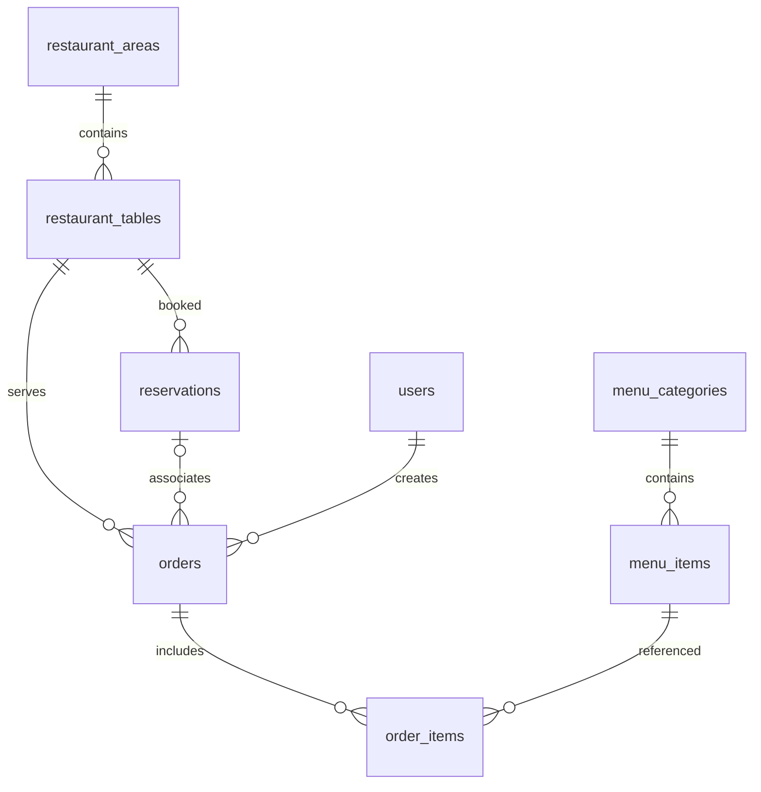

# Database Schema — TableFlow

Trạng thái: thiết kế nền tảng v1, cần hai thành viên review trước khi viết `schema.sql`. MySQL 8.x, InnoDB, utf8mb4. Không phải kết quả triển khai đã kiểm thử.

## 1. Quy ước

- PK: khóa chính; FK: khóa ngoại; UQ: unique; NN: NOT NULL. Các cột không ghi NULL là NN.
- ID: BIGINT UNSIGNED AUTO_INCREMENT (trừ change_events); timestamp nghiệp vụ lưu UTC bằng DATETIME(6), API chuyển ISO 8601 có offset; múi giờ hiển thị Asia/Ho_Chi_Minh. Kết nối DB dùng UTC.
- Tiền VND: DECIMAL(12,0), không âm; API trả số nguyên VND. Các bảng nghiệp vụ có `created_at`, `updated_at` DATETIME(6) trừ change_events chỉ có created_at. Ứng dụng cập nhật timestamp khi ghi.
- Không xóa cứng dữ liệu có lịch sử giao dịch; FK mặc định RESTRICT. Dữ liệu mẫu không chứa thông tin khách thật.

## 2. Danh sách bảng và cột

| Bảng | Cột và ràng buộc |
|---|---|
| users | id PK; username VARCHAR(80) UQ; password_hash VARCHAR(255); display_name VARCHAR(120); role ENUM('staff','admin'); is_active BOOLEAN DEFAULT TRUE; created_at; updated_at |
| restaurant_areas | id PK; name VARCHAR(100) UQ; is_active BOOLEAN DEFAULT TRUE; created_at; updated_at |
| restaurant_tables | id PK; area_id BIGINT UNSIGNED FK restaurant_areas.id; table_number VARCHAR(30) UQ; capacity INT UNSIGNED CHECK > 0; physical_status ENUM('available','occupied','cleaning','out_of_service') DEFAULT 'available'; position_x DECIMAL(5,2); position_y DECIMAL(5,2); created_at; updated_at |
| reservations | id PK; reservation_code VARCHAR(40) UQ; table_id BIGINT UNSIGNED FK restaurant_tables.id; customer_name VARCHAR(120); phone VARCHAR(20); party_size INT UNSIGNED CHECK > 0; start_at DATETIME(6); end_at DATETIME(6) CHECK end_at > start_at; status ENUM('pending','confirmed','checked_in','completed','cancelled') DEFAULT 'pending'; note VARCHAR(500) NULL; created_at; updated_at |
| menu_categories | id PK; name VARCHAR(100) UQ; is_active BOOLEAN DEFAULT TRUE; created_at; updated_at |
| menu_items | id PK; category_id BIGINT UNSIGNED FK menu_categories.id; name VARCHAR(150); description VARCHAR(500) NULL; price DECIMAL(12,0) CHECK >= 0; is_available BOOLEAN DEFAULT TRUE; created_at; updated_at |
| orders | id PK; table_id BIGINT UNSIGNED FK restaurant_tables.id; reservation_id BIGINT UNSIGNED NULL FK reservations.id; created_by BIGINT UNSIGNED FK users.id; status ENUM('open','completed','cancelled') DEFAULT 'open'; total_amount DECIMAL(12,0) CHECK >= 0; created_at; updated_at |
| order_items | id PK; order_id BIGINT UNSIGNED FK orders.id; menu_item_id BIGINT UNSIGNED FK menu_items.id; quantity INT UNSIGNED CHECK > 0; unit_price DECIMAL(12,0) CHECK >= 0; created_at; updated_at; UQ(order_id,menu_item_id) |
| change_events | id BIGINT UNSIGNED PK (cấp tuần tự theo cơ chế bên dưới, không AUTO_INCREMENT); event_type VARCHAR(60); entity_id BIGINT UNSIGNED; payload JSON; created_at DATETIME(6) |

`position_x`, `position_y`: phần trăm trong sơ đồ khu vực, CHECK 0–100. Boolean lưu 0/1; API chuyển true/false. `entity_id` là ID của thực thể theo event_type, không phải FK đa hình.

## 3. Quan hệ

## 4. Index

- reservations(table_id,status,start_at,end_at); reservations(status,start_at); UQ reservation_code.
- restaurant_tables(area_id,physical_status,capacity); menu_items(category_id,is_available).
- orders(table_id,status); orders(reservation_id); order_items UQ(order_id,menu_item_id); index menu_item_id; orders(created_by).
- change_events PK(id) phục vụ `WHERE id > :since_id ORDER BY id ASC LIMIT 100`.
- Kiểm tra EXPLAIN trên dữ liệu thật; không khẳng định hiệu quả trước khi đo.

## 5. Transaction và đồng thời

Mọi thao tác đặt bàn hoặc thay đổi lịch/trạng thái liên quan phải khóa hàng restaurant_tables bằng SELECT ... FOR UPDATE trước khi đọc và cập nhật reservation. Với nhiều bàn, khóa theo ID tăng dần. Dùng READ COMMITTED hoặc locking read để kiểm tra dữ liệu hiện tại; không dùng snapshot cũ. Kiểm tra overlap: `start_at < new_end_at AND end_at > new_start_at` với status pending, confirmed, checked_in; loại chính reservation đang sửa nếu có. Nếu xung đột rollback, trả 409. Không dùng UNIQUE(table_id,start_at) làm biện pháp duy nhất.

Sự kiện: dùng một hàng sentinel trong change_events (id=0, event_type='system.sequence', entity_id=0, payload chứa `last_id`:0). Seed/schema khởi tạo một lần. Trong cùng transaction, sau khóa nghiệp vụ, khóa sentinel FOR UPDATE, tăng last_id, insert event với ID vừa cấp, rồi commit; nhiều event cấp theo thứ tự. Không đưa sentinel vào API. Như vậy ID được cấp theo thứ tự commit của các transaction có event, tránh cursor bỏ sót do AUTO_INCREMENT commit lệch thứ tự. Không khóa sentinel trước hàng nghiệp vụ; không giữ transaction mở khi long polling. Giữ lịch sử event trong MVP, không tự xóa. Nếu thay đổi cơ chế này phải review cả hai luồng. Sentinel là quyết định thiết kế đề xuất cần nhóm kiểm thử.

Order: khóa bàn trước, sau đó order; xác nhận reservation nếu có thuộc cùng bàn; tính total_amount từ SUM(quantity*unit_price) trong transaction; unit_price là giá tại thời điểm thêm món. Không tin giá do client gửi.

## 6. Seed và migration

- Seed khu vực, bàn có nhiều sức chứa, menu, tài khoản test staff/admin (password_hash tạo bằng password_hash PHP), một số reservation hợp lệ và sentinel.
- Không commit mật khẩu thật. Tài khoản test và cách tạo phải có trong README trước khi nộp.
- `schema.sql` tạo DB tables; `seed.sql` dữ liệu mẫu; migration có thứ tự, review PR và đồng bộ cả hai máy. Không chạy seed phá dữ liệu thật. Dùng DB test riêng cho tests.

Xem [Business Rules](BUSINESS_RULES.md) và [API Contract](API_CONTRACT.md).
