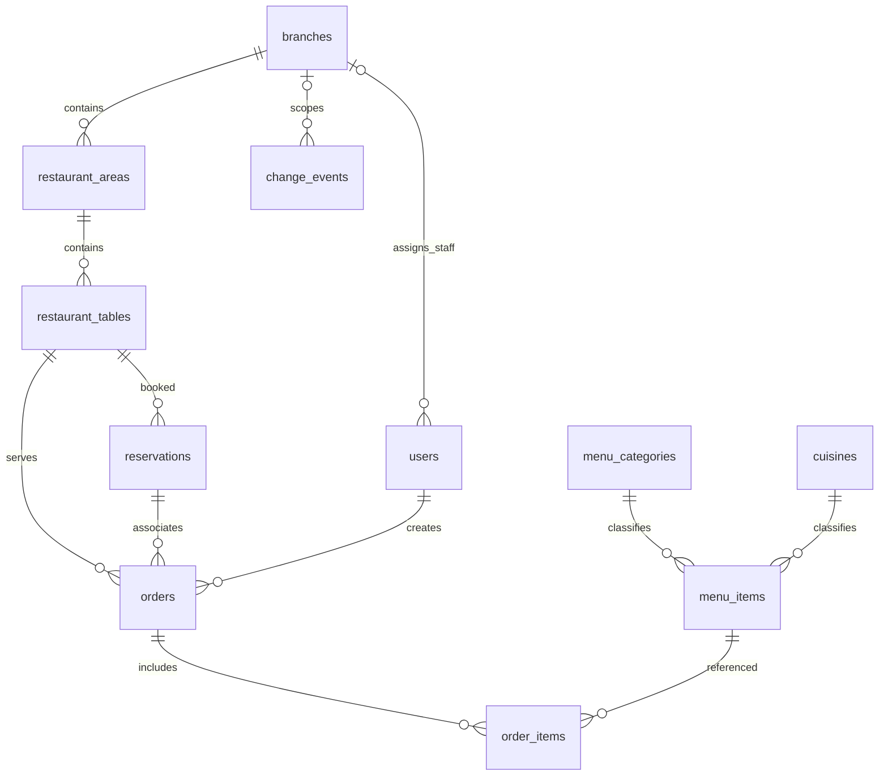

# Database Schema — TableFlow v2

Baseline thiết kế nhiều chi nhánh; đồng bộ với `database/schema.sql` và `seed.sql`. MySQL 8.0.16+ (CHECK được thực thi), InnoDB, utf8mb4. Chưa chạy import trên MySQL; không phải migration từ v1.

## 1. Quy ước

- PK: khóa chính; FK: khóa ngoại; UQ: unique. Các trường không ghi NULL là NOT NULL. ID BIGINT UNSIGNED AUTO_INCREMENT, trừ change_events cấp tuần tự. ID API giới hạn trong miền số nguyên an toàn JavaScript.
- `created_at`, `updated_at`: DATETIME(6), UTC, do ứng dụng cập nhật; change_events chỉ có created_at. UI dùng Asia/Ho_Chi_Minh; giờ mở cửa là TIME địa phương. Tiền VND DECIMAL(12,0), API số nguyên; rate DECIMAL(5,2) theo phần trăm (5.00 là 5%).
- FK mặc định NO ACTION (InnoDB tương đương RESTRICT), không xóa cứng lịch sử; dữ liệu demo không chứa thông tin thật. `image_url` NULL cho đến khi có ảnh được phép sử dụng, dùng đường dẫn tương đối hoặc URL HTTPS đã kiểm tra, không hardcode host triển khai.

## 2. 11 bảng và trường dữ liệu

Mỗi bảng có `id` PK và timestamps như mục 1. FK mặc định BIGINT UNSIGNED.

| Bảng | Các trường ngoài id/timestamps và ràng buộc |
|---|---|
| branches | branch_code VARCHAR(30) UQ; name VARCHAR(150); city VARCHAR(100); address VARCHAR(255) NULL; phone VARCHAR(20) NULL; opening_time TIME; closing_time TIME; is_active BOOLEAN DEFAULT TRUE; 00:00 <= opening_time < closing_time <= 23:59:59 |
| users | branch_id FK branches NULL; username VARCHAR(80) UQ; password_hash VARCHAR(255); display_name VARCHAR(120); role ENUM(staff,admin); is_active BOOLEAN DEFAULT TRUE; staff bắt buộc branch_id, admin bắt buộc NULL |
| restaurant_areas | branch_id FK branches; name VARCHAR(100); area_type ENUM(outdoor,indoor,vip,quiet); description TEXT NULL; image_url VARCHAR(255) NULL; is_active BOOLEAN DEFAULT TRUE; UQ(branch_id,area_type), UQ(id,branch_id,area_type) |
| restaurant_tables | area_id, branch_id, area_type (ENUM giống areas); FK ghép (area_id,branch_id,area_type) -> areas(id,branch_id,area_type); table_number VARCHAR(30); capacity TINYINT UNSIGNED IN(2,4,6,8), quiet <=4; physical_status ENUM(available,occupied,cleaning,out_of_service) DEFAULT available; position_x/y DECIMAL(5,2) CHECK 0–100; UQ(branch_id,table_number) |
| reservations | reservation_code VARCHAR(40) UQ; table_id FK restaurant_tables; customer_name VARCHAR(120); phone VARCHAR(20); party_size INT UNSIGNED 1–8; start_at/end_at DATETIME(6), end_at > start_at; status ENUM(pending,confirmed,checked_in,completed,cancelled) DEFAULT pending; note VARCHAR(500) NULL; UQ(id,table_id) |
| menu_categories | name VARCHAR(100) UQ; is_active BOOLEAN DEFAULT TRUE |
| cuisines | name VARCHAR(100) UQ; is_active BOOLEAN DEFAULT TRUE |
| menu_items | category_id FK menu_categories; cuisine_id FK cuisines; name VARCHAR(150); description VARCHAR(500) NULL; price DECIMAL(12,0) >=0; image_url VARCHAR(255) NULL; is_available BOOLEAN DEFAULT TRUE |
| orders | table_id FK restaurant_tables; reservation_id NOT NULL; FK ghép (reservation_id,table_id) -> reservations(id,table_id); created_by FK users; status ENUM(open,completed,cancelled) DEFAULT open; subtotal_amount, vip_fee, total_amount DECIMAL(12,0) >=0; vip_rate DECIMAL(5,2) IN(0,5); CHECK vip_fee = ROUND(subtotal_amount*vip_rate/100,0), total_amount=subtotal_amount+vip_fee |
| order_items | order_id FK orders; menu_item_id FK menu_items; quantity INT UNSIGNED >0; unit_price DECIMAL(12,0) >=0; UQ(order_id,menu_item_id) |
| change_events | id BIGINT UNSIGNED PK không AUTO_INCREMENT; branch_id FK branches NULL; event_type VARCHAR(60); entity_id BIGINT UNSIGNED; payload JSON; created_at; id=0 sentinel; event nghiệp vụ chi nhánh có branch_id, menu.updated toàn hệ thống có NULL |

Boolean CHECK 0/1. `entity_id` là ID đa hình theo event_type, không phải FK. `branch_id`, `area_type` trong restaurant_tables được lưu có chủ đích để SQL kiểm tra mã bàn theo chi nhánh và giới hạn sức chứa quiet; FK ghép ngăn lệch dữ liệu. Reservation và order suy ra chi nhánh qua table_id, không lặp branch_id. Quyền của created_by và sức chứa reservation phải kiểm tra ở backend; CHECK không thể tham chiếu bảng khác.

## 3. Quan hệ ERD

Admin không thuộc chi nhánh riêng; quan hệ users-branches chỉ áp dụng staff. Thực đơn và giá dùng chung, không có bảng giá theo chi nhánh.

## 4. Index và transaction

- branches(city,is_active); areas(branch_id,area_type) unique; tables(branch_id,table_number) unique; tables(area_id,physical_status,capacity).
- reservations(table_id,status,start_at,end_at), reservations(status,start_at); menu_items(category_id,is_available), menu_items(cuisine_id,is_available); orders(table_id,status), orders(reservation_id), orders(created_by); order_items(menu_item_id); change_events(branch_id,id) và PK(id).
- Kiểm tra EXPLAIN trên MySQL thực tế trước khi khẳng định hiệu năng.
- Mọi thao tác tạo reservation/thay đổi lịch hoặc trạng thái/ghi order khóa hàng restaurant_tables `SELECT ... FOR UPDATE` trước, tiếp theo reservation/order; khóa nhiều bàn theo id tăng dần. Dùng READ COMMITTED hoặc locking read cho dữ liệu hiện tại. Kiểm tra chi nhánh, quyền, capacity, lịch và trạng thái trong transaction. Overlap: `start_at < new_end_at AND end_at > new_start_at` với pending/confirmed/checked_in. Nếu conflict rollback, 409. Không chỉ dựa UNIQUE(table_id,start_at).
- Tính tiền order từ SUM(quantity*unit_price), giá chụp từ menu khi tạo. vip_rate xác định từ area_type của bàn (5 nếu vip, 0 nếu khác), lưu snapshot; ROUND tiền phụ phí đến VND. Không tin giá hay rate từ client; kiểm tra overflow DECIMAL(12,0). Khi thanh toán/hoàn thành chỉ đổi trạng thái, giữ giá snapshot.
- Event sequence: sentinel id=0, branch_id=NULL, event_type='system.sequence', entity_id=0, payload `{last_id:0}`. Sau mọi khóa nghiệp vụ, khóa sentinel FOR UPDATE, tăng last_id, insert event cùng transaction rồi commit. Nhiều event cấp theo thứ tự. Không khóa sentinel trước nghiệp vụ, không trả sentinel, không giữ transaction khi polling. ID toàn hệ thống có thứ tự commit, có khoảng trống trong luồng đã lọc theo branch. Không xóa event trong MVP. Menu global có branch_id NULL; mọi event khác gắn branch thực tế của bàn. Payload chỉ ID/trạng thái, không PII.

## 5. Dữ liệu mẫu chính thức của bản v2

| Địa phương | Mã và tên chi nhánh giả lập |
|---|---|
| TP. Hồ Chí Minh | HCM01 Quận 1; HCM02 Quận 7 |
| Hà Nội | HN01 Hoàn Kiếm; HN02 Cầu Giấy |
| Đà Nẵng | DN01 Hải Châu; DN02 Sơn Trà |
| Đà Lạt | DL01 Hồ Xuân Hương; DL02 Tuyền Lâm |
| Phú Quốc | PQ01 Dương Đông; PQ02 An Thới |

Địa danh dùng làm nhãn demo, không phải địa chỉ hành chính/kinh doanh đã xác minh. Địa chỉ, phone và ảnh chi nhánh/khu vực/món chưa có dữ liệu thật: NULL. Giờ mẫu 10:00–22:00 mỗi ngày.

| Khu vực | Bàn 2 | Bàn 4 | Bàn 6 | Bàn 8 | Tổng bàn | Chỗ |
|---|---:|---:|---:|---:|---:|---:|
| outdoor | 2 | 3 | 2 | 1 | 8 | 36 |
| indoor | 3 | 3 | 2 | 1 | 9 | 38 |
| vip | 1 | 2 | 2 | 1 | 6 | 30 |
| quiet | 3 | 3 | 0 | 0 | 6 | 18 |
| Tổng/chi nhánh | 9 | 11 | 6 | 3 | 29 | 122 |
| Toàn hệ thống | 90 | 110 | 60 | 30 | 290 | 1220 |

Mã bàn OUT-01…08, IN-01…09, VIP-01…06, QT-01…06; trùng giữa chi nhánh được phép. Tọa độ seed là lưới minh họa, không phải bản vẽ mặt bằng thật. 40 khu vực, 10 staff, 1 admin, 4 menu_categories, 4 cuisines (Việt Nam, Ấn Độ, Thái Lan, Quốc tế), 36 menu_items, 7 reservation mẫu, 2 order mẫu (thường/VIP), 6 order_items, 1 sentinel. Xem seed.sql cho toàn bộ giá và tên món; các món thuộc 9 khai vị, 13 món chính, 6 tráng miệng, 8 nước uống.

## 6. Import và migration

Chọn DB rỗng mới, chạy schema.sql rồi seed.sql một lần bằng MySQL client không bật --force. Dừng khi lỗi, rollback seed nếu lỗi; DDL MySQL không rollback toàn bộ, cần kiểm tra DB nếu schema chạy dở. Không xóa hay chạy đè dữ liệu v1. Nếu đã có dữ liệu cần giữ, thiết kế migration riêng và review. Hai máy dùng chung version schema; DB test riêng. Hash 11 tài khoản được tạo/verify bằng PHP (chỉ tài khoản demo). Chưa chạy MySQL thực tế.

Xem [Business Rules](BUSINESS_RULES.md), [API Contract](API_CONTRACT.md).
